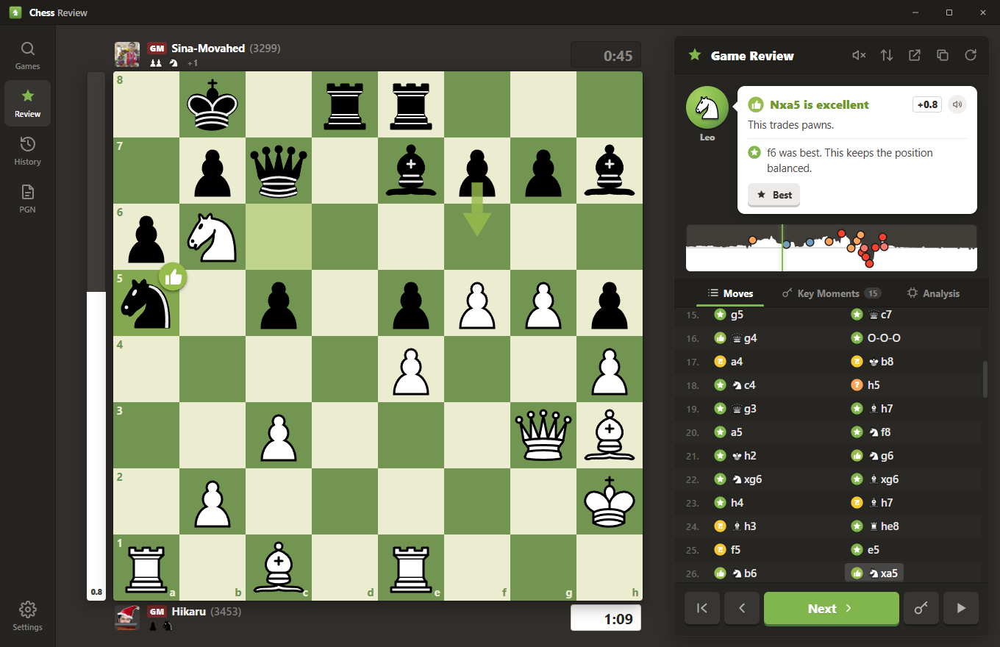
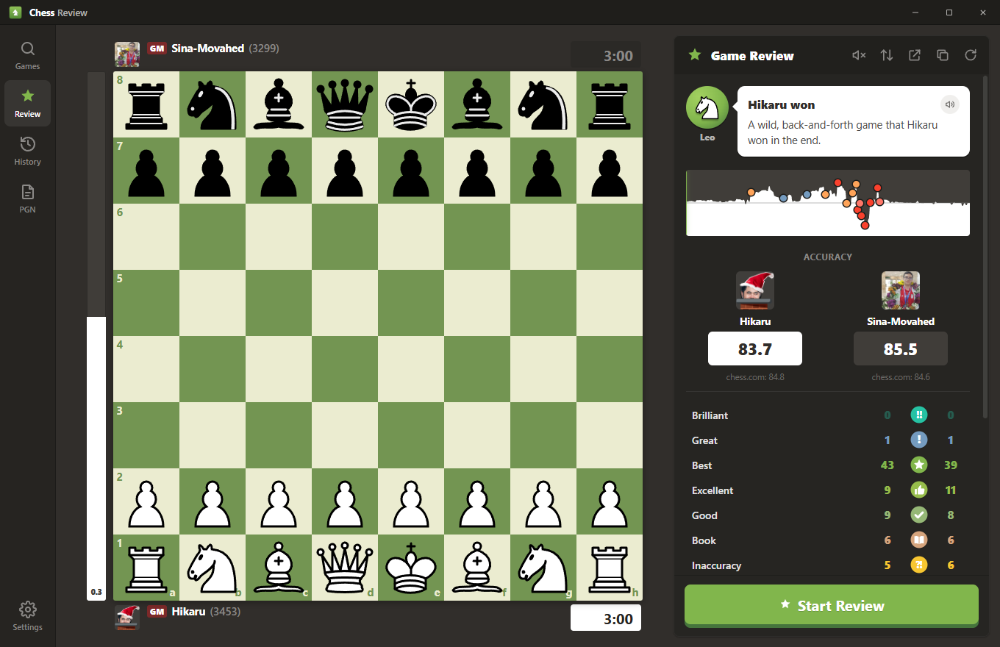
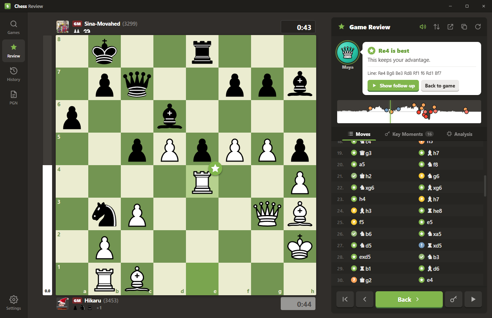
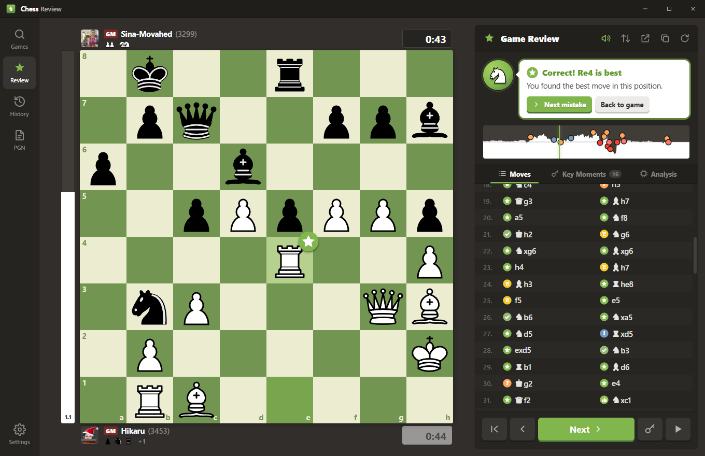
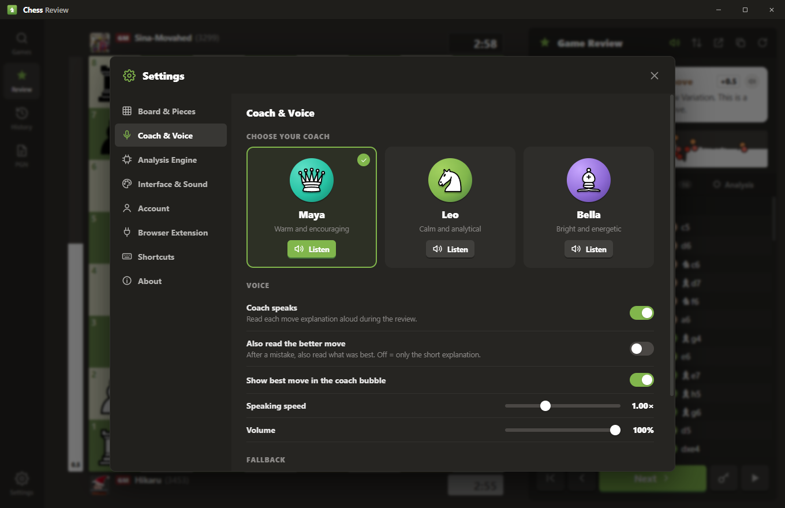
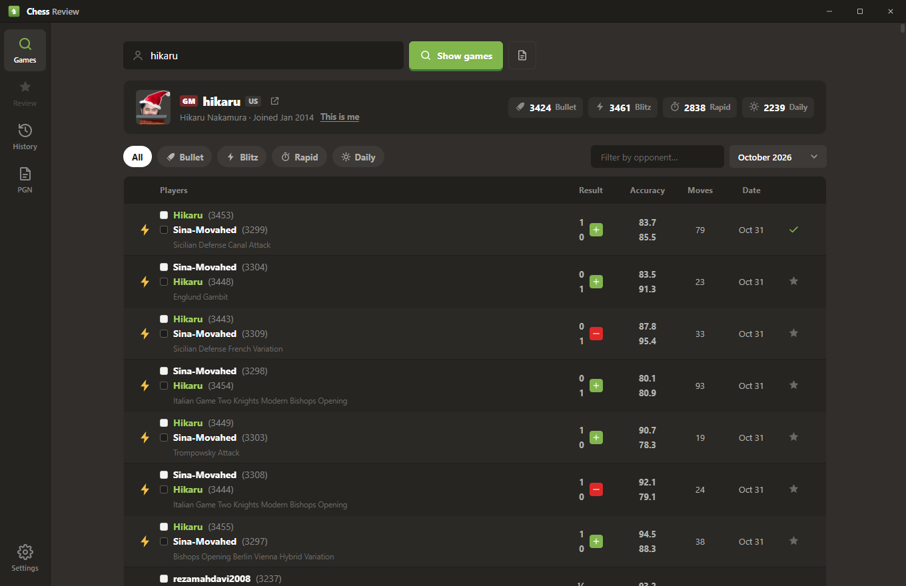

# Chess Review

**Fast, beautiful, offline game review for your chess.com games.** 
Move classifications, accuracy, an eval graph and a coach who talks you through every move.

Chess.com reviews · open source.

[**Download**](../../releases/latest)

[Features](#-features) · [Browser extension](#-browser-extension) · [Build from source](#%EF%B8%8F-build-from-source)

 

 

## Features

<table>
<tr>
<td width="50%" valign="top">

### Every move, classified
Brilliant, Great, Best, Excellent, Good, Book, Inaccuracy, Mistake, Miss and Blunder. Each move gets a badge on the board, tinted squares and a green arrow for the better move.

### A coach that actually talks
Pick **Maya**, **Leo** or **Bella**. Each coach has a natural neural voice that runs fully offline and explains *why* a move was good or bad: hanging pieces, forks, missed mates, material won.

### Accuracy & game rating
Per-player accuracy, an estimated game rating and phase grades for the opening, middlegame and endgame. If chess.com already reviewed the game, its accuracy is shown alongside for comparison.

</td>
<td width="50%" valign="top">

### Retry your mistakes
Jump into any inaccuracy, mistake or blunder and find the better move yourself, with hints, the solution and confetti when you get it right.

### Key moments & live analysis
Skip straight to the turning points, see live Stockfish lines, or drag any piece to explore your own ideas. Every explored move gets classified too.

### One click from chess.com
The browser extension makes chess.com's own **Game Review** buttons open the game here instead. Switch back any time from the toolbar.

</td>
</tr>
</table>

 

<table>
<tr>
<td align="center"> <b>Game summary</b>: accuracy, ratings, move counts</td>
<td align="center"> <b>Best move</b>: takes back the mistake and plays the engine's choice</td>
</tr>
<tr>
<td align="center"> <b>Retry</b>: find the better move yourself</td>
<td align="center"> <b>Three coaches</b>, each with their own voice</td>
</tr>
<tr>
<td align="center" colspan="2"> <b>Your games</b>: type a chess.com username and pick any game</td>
</tr>
</table>

 

## Download

1. Grab **`Chess-Review-1.0-Windows.zip`** from the [latest release](../../releases/latest).
2. Unzip it somewhere permanent (for example `Documents\Chess Review`).
3. Run **`Chess Review.exe`**.

> [!NOTE]
> On first launch the app offers two one-time downloads: the **Stockfish 19** engine (~80 MB) and the **coach voices** (~380 MB). After that, everything runs offline on your computer. No account, no login, no tracking.

Type your chess.com username, click a game and press **Start Review**.

 

## Browser extension

Works in Chrome, Edge, Brave and Opera.

1. Open `chrome://extensions` (or `edge://extensions`) and turn on **Developer mode**.
2. Click **Load unpacked** and choose the `extension` folder from the zip.
3. That's it. chess.com's **Game Review** buttons now open the game in Chess Review:

| Where on chess.com | What happens |
|---|---|
| Finished game page | *Game Review* opens the review in the app |
| Game-over screen | *Game Review* opens the review in the app |
| Your archive & profile | The review / accuracy link opens the review in the app |

Click the extension's toolbar icon to switch between **Chess Review** and **chess.com** for those buttons, and to see whether the app is running.

> [!TIP]
> While the app is open, reviews open instantly. When it's closed, the browser asks once to start Chess Review. Tick **Always allow**.

 

## Keyboard shortcuts

| Key | Action | | Key | Action |
|:---:|---|---|:---:|---|
| <kbd>←</kbd> <kbd>→</kbd> | Previous / next move | | <kbd>F</kbd> | Flip board |
| <kbd>↑</kbd> <kbd>↓</kbd> | Previous / next key moment | | <kbd>B</kbd> | Show best move |
| <kbd>Home</kbd> <kbd>End</kbd> | Start / end of game | | <kbd>R</kbd> | Retry this mistake |
| <kbd>Space</kbd> | Autoplay | | <kbd>Esc</kbd> | Back to the game |

Right-drag on the board draws arrows and marks squares. The mouse wheel steps through moves.

 

## Make it yours

Everything is customizable from **Settings**:

- **Board:** 14 themes, 12 piece sets, coordinates, animation speed, arrows, badges, eval bar, clocks, figurine notation
- **Coach:** choose your coach, speaking speed and volume, and whether to also read the better move
- **Engine:** strength presets (Fast → Maximum), search depth, parallel engines, threads, hash, or your own UCI engine
- **Interface:** Classic, Midnight or Slate theme, accent color, interface size, sounds

 
